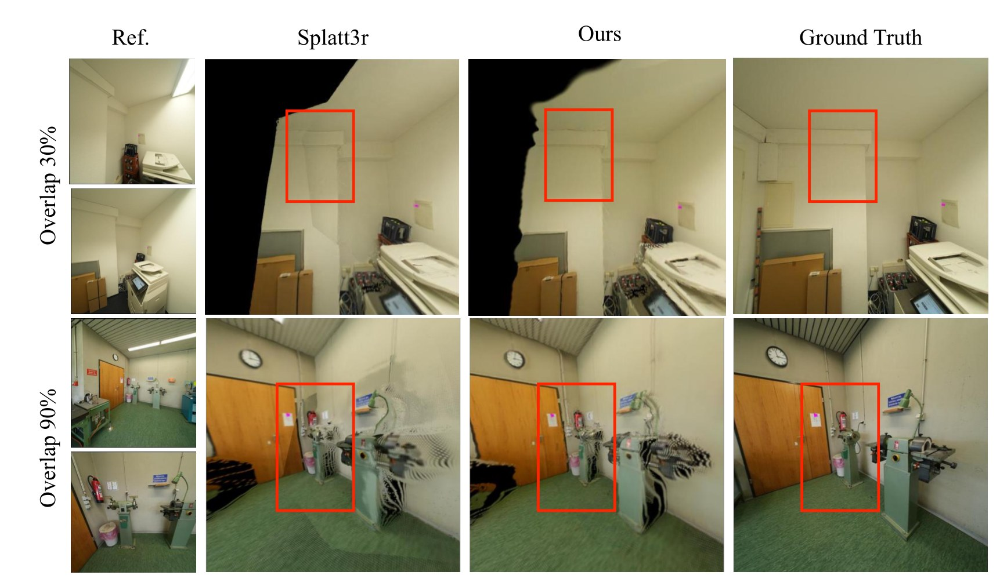
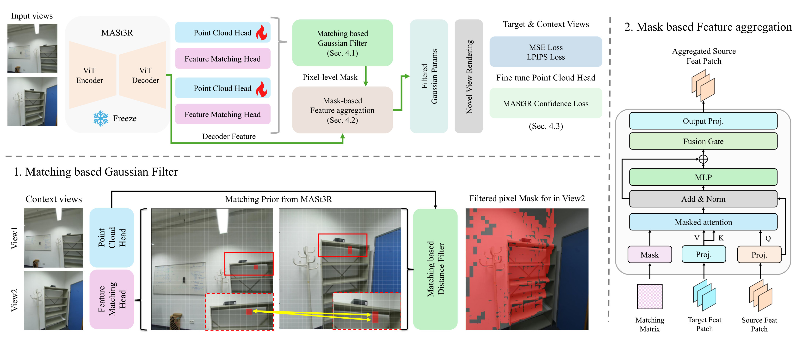

<div align="center">

# CSG-Fusion: Consistent Sparse-View Gaussian Splatting via Matching-based Fusion

**Feed-forward 3D Gaussian Splatting from two unposed images — fewer, consistent Gaussians, better novel views.**

**Yan Xia**<sup>*1</sup> · **Wenbo Ji**<sup>*2,3</sup> · **Weirong Chen**<sup>2,3</sup> · **Daniel Cremers**<sup>2,3</sup>

<sup>1</sup>USTC · <sup>2</sup>TUM · <sup>3</sup>MCML

<sup>*</sup> Equal contribution

E2E3D Workshop @ ICCV 2025 · 🏆 **Best Paper Award**

<a href='https://fusheng-ji.github.io/CSG_Fusion/'></a>
<a href='https://openaccess.thecvf.com/content/ICCV2025W/E2E3D/papers/Xia_CSG-Fusion_Consistent_Sparse-View_Gaussian_Splatting_via_Matching-based_Fusion_ICCVW_2025_paper.pdf'></a>
<a href='https://openaccess.thecvf.com/content/ICCV2025W/E2E3D/supplemental/Xia_CSG-Fusion_Consistent_Sparse-View_ICCVW_2025_supplemental.pdf'></a>
<a href='assets/CSG-Fusion-poster.pdf'></a>
<a href='https://doi.org/10.1109/ICCVW69036.2025.00276'></a>
<a href='https://huggingface.co/fushengji/CSG-Fusion'></a>
<a href='LICENSE'></a>



*CSG-Fusion achieves better rendering quality than Splatt3R with significantly fewer Gaussian primitives (ScanNet++, 30% and 90% view overlap).*

</div>

## News

- **2025-10**: CSG-Fusion receives the **Best Paper Award** at the ICCV 2025 Workshop on End-to-End 3D Learning (E2E3D).
- **Code release**: training, evaluation, demo, pretrained models on Hugging Face, and an evaluation of CSG-Fusion and nine feed-forward Gaussian splatting baselines on ScanNet++.

## TL;DR

**CSG-Fusion** is a **feed-forward 3D Gaussian Splatting (3DGS)** model for **sparse-view novel view synthesis**. It takes **two RGB images with no camera poses and no intrinsics** and, in a single forward pass, outputs one **metric-scale set of 3D Gaussians** that can be rendered from new viewpoints or exported as a standard `.ply` file.

Pose-free, pixel-aligned methods such as **Splatt3R** (built on the **MASt3R** pointmap model) predict one Gaussian per pixel in each view, so the region both images see is reconstructed twice, with duplicated and slightly inconsistent primitives. CSG-Fusion fuses the two views instead:

- **Matching-based Gaussian Filter** (Sec. 4.1). Dense MASt3R correspondences plus a 3D distance threshold find the view-2 Gaussians that duplicate a view-1 Gaussian and remove them (`dist_threshold`, 0.07 m in the published model).
- **Mask-based Feature Aggregation** (Sec. 4.2). Masked cross-view attention moves the features of the removed, matched patches into the Gaussians that remain (`use_attention`, `attention_neighbor`).
- **Context-view supervision** (Sec. 4.3). The fused Gaussians are also rendered at the two input views (MSE + LPIPS), and the MASt3R point-cloud heads are fine-tuned with the MASt3R confidence loss (`context_loss`, `loss.mast3r_loss_weight`).

On **ScanNet++**, CSG-Fusion beats Splatt3R at every view overlap (+1.1 to +2.5 dB PSNR in the [uniform re-evaluation](#uniform-re-evaluation)) with fewer Gaussians.

<p align="center"></p>

## Quick start

You need Linux, conda and an NVIDIA GPU with about 6 GB of memory; the checkpoint is a 3 GB download. GPUs that need CUDA ≥ 12.8 use `environment-cu128.yml` (see [Installation](#installation)).

```bash
git clone https://github.com/fusheng-ji/CSG_Fusion.git && cd CSG_Fusion
git submodule update --init --recursive third_party/diff-gaussian-rasterization
conda env create -f environment.yml && conda activate csg_fusion
bash scripts/install_rasterizers.sh

# two images of the same scene; the published model is downloaded from Hugging Face
python demo.py --image1 path/to/a.jpg --image2 path/to/b.jpg --out demo_out/
# more images, without retraining (see Multi-view inference)
python demo.py --images path/to/a.jpg path/to/b.jpg path/to/c.jpg --out demo_out/
```

The script prints how many Gaussians it keeps and writes to `demo_out/`:

| File | Content |
|---|---|
| `gaussians.ply` | The fused Gaussians, for any 3DGS viewer, e.g. [SuperSplat](https://superspl.at/editor) |
| `input_*.png`, `render_*.png` | The 512×512 inputs and the Gaussians rendered at the input cameras |
| `trajectory.mp4` | A fly-through over the input cameras |
| `cameras.json` | The estimated focal length and camera poses |

## Results

### As published

ScanNet++ novel view synthesis at different view overlaps, as reported in the paper, at 256×256. Each baseline's numbers come from its own evaluation code.

| Method | Close 90% PSNR↑ | SSIM↑ | LPIPS↓ | Medium 70% PSNR↑ | SSIM↑ | LPIPS↓ | Wide 50% PSNR↑ | SSIM↑ | LPIPS↓ | Very Wide 30% PSNR↑ | SSIM↑ | LPIPS↓ |
|---|---|---|---|---|---|---|---|---|---|---|---|---|
| pixelSplat (GT cams) | 25.623 | 0.856 | 0.184 | 23.379 | 0.827 | 0.202 | 22.021 | 0.816 | 0.208 | 20.819 | 0.818 | 0.202 |
| MVSplat (GT cams) | 16.053 | 0.582 | 0.415 | 14.285 | 0.527 | 0.430 | 13.530 | 0.536 | 0.417 | 13.159 | 0.574 | 0.387 |
| NoPoSplat\* | 17.571 | 0.653 | 0.343 | 15.401 | 0.610 | 0.373 | 14.616 | 0.621 | 0.368 | 14.669 | 0.667 | 0.331 |
| Splatt3R | 16.479 | 0.679 | 0.231 | 17.302 | 0.718 | 0.194 | 17.763 | 0.746 | 0.183 | 17.746 | 0.772 | 0.186 |
| **CSG-Fusion (ours)** | **19.277** | **0.730** | **0.186** | **19.249** | **0.750** | **0.171** | **19.193** | **0.770** | **0.166** | **18.815** | **0.790** | **0.172** |

\* NoPoSplat is trained on RealEstate10K. Bold marks the best pose-free result. For DTU results and qualitative comparisons, see the [paper](https://openaccess.thecvf.com/content/ICCV2025W/E2E3D/papers/Xia_CSG-Fusion_Consistent_Sparse-View_Gaussian_Splatting_via_Matching-based_Fusion_ICCVW_2025_paper.pdf) and the [poster](assets/CSG-Fusion-poster.pdf).

### Uniform re-evaluation

All methods with one harness ([Baselines](#baselines)): the same test pairs (3336 at overlap 0.9, 4700 at the others), mask and metric code, each baseline with its upstream code and released checkpoint. PSNR / SSIM / LPIPS (AlexNet) of the masked renders, resized to 256×256. CSG-Fusion is the published checkpoint.

| Method | GT context poses | Target camera | 0.9 PSNR↑ | SSIM↑ | LPIPS↓ | 0.7 PSNR↑ | SSIM↑ | LPIPS↓ | 0.5 PSNR↑ | SSIM↑ | LPIPS↓ | 0.3 PSNR↑ | SSIM↑ | LPIPS↓ |
|---|---|---|---|---|---|---|---|---|---|---|---|---|---|---|
| pixelSplat | yes | GT | 26.21 | 0.873 | 0.137 | 23.87 | 0.844 | 0.156 | 22.47 | 0.831 | 0.169 | 21.19 | 0.829 | 0.179 |
| MVSplat | yes | GT | 23.97 | 0.832 | 0.163 | 21.43 | 0.787 | 0.194 | 19.99 | 0.770 | 0.214 | 18.91 | 0.774 | 0.227 |
| DepthSplat | yes | GT | 22.96 | 0.835 | 0.152 | 20.66 | 0.782 | 0.191 | 19.34 | 0.767 | 0.205 | 18.56 | 0.772 | 0.211 |
| NoPoSplat | scale† | GT | 12.59 | 0.495 | 0.503 | 12.85 | 0.537 | 0.467 | 13.39 | 0.590 | 0.432 | 14.21 | 0.656 | 0.378 |
| SPFSplat | no | predicted | 9.97 | 0.374 | 0.607 | 10.32 | 0.422 | 0.568 | 11.10 | 0.502 | 0.515 | 12.05 | 0.584 | 0.459 |
| SPFSplatV2-L | no | predicted | 11.38 | 0.432 | 0.554 | 12.18 | 0.512 | 0.470 | 13.36 | 0.595 | 0.400 | 14.54 | 0.670 | 0.336 |
| YoNoSplat | no | GT + test-time alignment | 16.29 | 0.614 | 0.392 | 15.86 | 0.622 | 0.378 | 15.76 | 0.656 | 0.358 | 16.01 | 0.705 | 0.319 |
| AnySplat | no | predicted | 22.21 | 0.780 | 0.138 | 19.53 | 0.743 | 0.171 | 18.20 | 0.738 | 0.186 | 17.38 | 0.753 | 0.185 |
| Splatt3R | no | GT | 17.84 | 0.676 | 0.234 | 18.73 | 0.716 | 0.196 | 19.25 | 0.746 | 0.183 | 19.18 | 0.772 | 0.184 |
| **CSG-Fusion (ours)** | no | GT | 20.38 | 0.733 | 0.188 | 20.47 | 0.749 | 0.173 | 20.57 | 0.770 | 0.166 | 20.32 | 0.791 | 0.170 |

**Training data.** Splatt3R and CSG-Fusion are trained on ScanNet++, AnySplat on a multi-dataset collection that includes it. The other baselines use their RealEstate10K checkpoints, zero-shot.

**Target camera.** *GT*: the ground-truth target pose places the novel view. *Predicted*: the method predicts the target camera from the target image. *GT + test-time alignment*: YoNoSplat optimises the GT target pose against the target image. † NoPoSplat gets the scene scale from the GT context poses.

**Input resolution.** Every method gets images at its own resolution, resized from the 512×512 crop. The encoder inputs of Splatt3R and CSG-Fusion are downsampled to 256×256 and upsampled back to 512×512.

### Efficiency

Cost of reconstructing two images and rendering one target view, on 100 ScanNet++ pairs (25 per overlap), batch 1, one GPU, each method with its released code and resolution. Times are medians over repeated passes, relative to CSG-Fusion.

| Method | Reconstruct | Target camera | Render | Total | Peak GPU memory (GiB) | of which weights | Peak host memory (GiB) | GMACs | Gaussian type | Gaussians | Parameters | Pixels per side |
|---|---:|---:|---:|---:|---:|---:|---:|---:|---:|---:|---:|---:|
| pixelSplat | 1.08× | – | 0.04× | 1.12× | 2.7 | 0.5 | 2.7 | 770 | pixel-wise, 3 each | 393k | 119M | 256 |
| MVSplat | 0.53× | – | 0.03× | 0.56× | 1.1 | <0.1 | 2.5 | 169 | pixel-wise | 131k | 12M | 256 |
| DepthSplat | 0.88× | – | 0.03× | 0.91× | 2.5 | 1.3 | 2.9 | 555 | pixel-wise | 131k | 354M | 256 |
| NoPoSplat | 0.95× | – | 0.04× | 0.99× | 2.6 | 2.3 | 2.1 | 406 | pixel-wise | 131k | 612M | 256 |
| Splatt3R | 1.44× | – | 0.04× | 1.49× | 3.3 | 2.7 | 2.1 | 1,653 | pixel-wise | 524k | 732M | 512 |
| **CSG-Fusion** | **0.95×** | **–** | **0.05×** | **1.00×** | **5.1** | **2.8** | **2.5** | **1,958** | **filtered** | **387k** | **740M** | **512** |
| SPFSplat | 1.02× | 0.53× | 0.04× | 1.59× | 2.6 | 2.3 | 2.2 | 406 | pixel-wise | 131k | 616M | 256 |
| SPFSplatV2-L | 0.88× | 0.02× | 0.03× | 0.94× | 4.8 | 4.6 | 2.1 | 617 | pixel-wise | 100k | 1223M | 224 |
| YoNoSplat | 0.99× | (27×) | 0.04× | 1.02× | 3.8 | 3.6 | 2.4 | 772 | filtered | 71k | 965M | 224 |
| AnySplat | 1.68× | 0.95× | 0.03× | 2.67× | 3.5 | 2.7 | 3.5 | 2,786 | voxel-merged | 365k | 1191M | 448 |

- *Target camera*: extra time of the methods that estimate it; in brackets, YoNoSplat's test-time pose alignment, which is not in its total.
- Peak GPU memory is allocated memory, weights included; peak host memory is the resident set size during inference. GMACs count matrix products, convolutions and attention of the reconstruction.
- *Gaussian type*: pixel-wise methods predict a fixed number per pixel; *filtered* ones then drop some (CSG-Fusion the matched view-2 Gaussians, YoNoSplat those with opacity ≤ 0.005); AnySplat merges the Gaussians of a voxel. Counts depend on the resolution; voxel-merged ones do not compare with the others.

```bash
python -m scripts.eval.bench_efficiency pairs && python -m scripts.eval.bench_efficiency all    # on an idle GPU
python -m scripts.eval.summarize_efficiency
```

## Installation

Tested on Linux with CUDA 12.1, Python 3.11 and PyTorch 2.5.1. For GPUs that need CUDA ≥ 12.8 (e.g. NVIDIA Blackwell), use `environment-cu128.yml` (PyTorch 2.7, env `csg_fusion_cu128`) instead of `environment.yml`. Besides the steps of the [Quick start](#quick-start):

```bash
git submodule update --init third_party/vggt                                      # optional: VGGT backbone
git submodule update --init --recursive third_party/baselines                     # optional: baseline evaluation
pip install -r requirements-baselines.txt                                         # optional: baseline evaluation (its header lists the compiler settings)
```

`scripts/install_rasterizers.sh` builds the rasterizer ([our fork](https://github.com/fusheng-ji/diff-gaussian-rasterization) of [dcharatan's modified rasterizer](https://github.com/dcharatan/diff-gaussian-rasterization-modified), which skips zero-opacity Gaussians) and the optional CUDA RoPE kernel (`perf.rope=cuda`; `--no-rope` skips it). It compiles for the GPUs of the machine it runs on; set `TORCH_CUDA_ARCH_LIST` (e.g. `"8.6"`) to build for another GPU.

## Checkpoints

| File | Purpose |
|---|---|
| [`checkpoint/csg_fusion.ckpt`](https://huggingface.co/fushengji/CSG-Fusion) (3.0 GB) | **The published CSG-Fusion model**. Needed for the demo and the evaluation; `demo.py` downloads it |
| [`checkpoint/csg_fusion_vggt.ckpt`](https://huggingface.co/fushengji/CSG-Fusion) (4.2 GB) | CSG-Fusion on the VGGT backbone; `demo.py --vggt` downloads it |
| `checkpoint/MASt3R_ViTLarge_BaseDecoder_512_catmlpdpt_metric.pth` | Pretrained MASt3R backbone, for training, from the [MASt3R repo](https://github.com/naver/mast3r) |
| [`facebook/VGGT-1B`](https://huggingface.co/facebook/VGGT-1B) | For training with the VGGT backbone. Downloaded on first use, or set `model.vggt_pretrained=<local snapshot dir>` |
| `checkpoint/epoch=19-step=1200.ckpt` | For the Splatt3R baseline: its official [checkpoint](https://huggingface.co/brandonsmart/splatt3r_v1.0) |
| `checkpoint/baselines/*` | For the other baselines: the checkpoint their README links, renamed to the path in `scripts/eval/baselines/__init__.py` (`re10k.ckpt` of pixelSplat is `pixelsplat_re10k.ckpt`, and so on; `anysplat` is a folder with the Hugging Face snapshot `lhjiang/anysplat`) |

```bash
mkdir -p checkpoint
huggingface-cli download fushengji/CSG-Fusion csg_fusion.ckpt --local-dir checkpoint     # CSG-Fusion
wget -P checkpoint https://download.europe.naverlabs.com/ComputerVision/MASt3R/MASt3R_ViTLarge_BaseDecoder_512_catmlpdpt_metric.pth   # training only
```

## Data preparation

All datasets live under `data/`, next to their loaders. The large folders are git-ignored.

```
data/
├── scannetpp/                         # ScanNet++ v1 (DSLR), training + main evaluation
│   ├── raw/                           # official download
│   │   ├── splits/nvs_sem_train.txt, nvs_sem_val.txt
│   │   └── data/<scene_id>/
│   │       ├── dslr/{train_test_lists.json, colmap/, resized_undistorted_images/,
│   │       │         nerfstudio/transforms.json, nerfstudio/transforms_undistorted.json}
│   │       └── scans/mesh_aligned_0.05.ply
│   ├── processed/<scene_id>/dslr/     # written by prepare_processed.py
│   │   ├── undistorted_images -> ../../../raw/data/<scene_id>/dslr/resized_undistorted_images
│   │   ├── undistorted_depths/*.png   # uint16, millimetres, 0 = invalid
│   │   └── nerfstudio/transforms_undistorted.json
│   ├── coverage/<scene_id>.json       # per-scene frame overlap (Splatt3R)
│   └── test_set_*.json                # test pairs per view overlap (in the repo)
└── dtu/test/                          # DTU, cross-dataset evaluation (*.torch, index.json)
```

### ScanNet++

1. **Download (ScanNet++ v1).** Request access on the [ScanNet++ website](https://scannetpp.mlsg.cit.tum.de/scannetpp/) and get the download script from your dashboard. Download only the 276 scenes that have a coverage file, and only these assets, into `data/scannetpp/raw` (≈80 GB):
   - `dslr_train_test_lists_path`, `dslr_nerfstudio_transform_path`, `dslr_nerfstudio_transform_undistorted_path`
   - `dslr_resized_undistorted_dir`, `dslr_colmap_dir`, `scan_mesh_path`

   In the download config, set `download_scenes` to the scene ids in `data/scannetpp/coverage/` and `download_assets` to the list above. Keep `version=v1` in the URL: the coverage files and test sets index the v1 frame lists (training frames minus `is_bad` ones).
2. **Coverage.** Download the per-scene coverage files from [Splatt3R on Hugging Face](https://huggingface.co/brandonsmart/splatt3r_v1.0/tree/main/scannetpp) into `data/scannetpp/coverage/` and delete `280b83fcf3.json` (not in the v1 splits). Training samples context/target pairs from the remaining 276 scenes. The test splits (`data/scannetpp/test_set_{0.3,0.5,0.7,0.9}_*.json`) are in the repo.
3. **Depth + processed layout.** Install [renderpy](https://github.com/liu115/renderpy) (headless OpenGL/EGL; see its README) into the environment, then run:

   ```bash
   python data/scannetpp/prepare_processed.py      # all downloaded scenes; resumable
   # or in parallel: N renderpy workers over the listed GPUs, test scenes first; --follow keeps up with an ongoing download
   PYTHON=$(which python) bash data/scannetpp/render_depth_parallel.sh --workers 6 --gpus 0 --follow
   ```

   This follows the Splatt3R/SplaTAM pipeline. It renders the mesh in the distorted fisheye DSLR camera (near 0.05 m, far 20 m), undistorts the depth with nearest-neighbour remapping into the official undistorted camera, and writes the `processed/` layout above. Rendering is per-process bound, so several workers per GPU speed it up. On a headless NVIDIA machine, set `__EGL_VENDOR_LIBRARY_FILENAMES=/usr/share/glvnd/egl_vendor.d/10_nvidia.json` so EGL uses the GPU.

Scenes `303745abc7` (train) and `cc5237fd77` (val) are skipped automatically because they have frames with no valid depth. So are scenes whose usable frames differ from their coverage file or test list (6 training and 2 validation scenes), because the frame indices then refer to other frames. The evaluation uses every 10th pair of the test lists: 3336 pairs at overlap 0.9 and 4700 at 0.7, 0.5 and 0.3.

### DTU

Download the processed DTU test set (`dtu.zip`, 394 MB) from [NoPoSplat](https://github.com/cvg/NoPoSplat/blob/main/DATASETS.md#dtu) and unpack it with `unzip dtu.zip -d data/`. The two-context-view evaluation index (from MVSplat) is in the repo at `data/dtu_index/evaluation_index_dtu_nctx2.json`. The loader scales the camera translations by 0.38 and the focal lengths by 1.23 for every method.

## Training

```bash
bash scripts/train/train.sh                                                   # CSG-Fusion (configs/csg_fusion.yaml), GPU 0
bash scripts/train/train.sh configs/ablations/dist_threshold_0.05.yaml        # any experiment config
GPUS=0,1 bash scripts/train/train.sh configs/base.yaml opt.epochs=5           # multi-GPU + key=value overrides
bash scripts/train/train.sh configs/csg_fusion_vggt.yaml                      # VGGT backbone
sbatch --export=ALL,CONFIG=configs/csg_fusion.yaml scripts/train/slurm_train.sbatch   # Slurm
```

`key=value` overrides go to `python main.py <config>`; the console output is also kept in `logs/`. The default batch size (10) needs a GPU with a lot of memory; lower `data.batch_size` or set `perf.checkpoint_gaussian_dpt=true` (about a third less peak memory) on smaller GPUs.

A run trains, then evaluates on the ScanNet++ test sets, and writes checkpoints, metrics and `results.json` to `results/<name>/`. `trainer.skip_test=True` skips the evaluation, `trainer.max_steps=N` stops early, and `name=<run> trainer.resume=True` continues a run.

| Config | What it trains |
|---|---|
| `configs/csg_fusion.yaml` | CSG-Fusion: filter threshold 0.07 m, context-view loss, MASt3R confidence loss |
| `configs/base.yaml` | Base of every config: filter (0.03 m) + feature aggregation, target-view loss only |
| `configs/csg_fusion_vggt.yaml` | CSG-Fusion on a frozen VGGT-1B backbone |
| `configs/ablations/dist_threshold_*.yaml` | Filter threshold sweep (0.01–0.10 m) on the base recipe |
| `configs/ablations/*_thr0.0*.yaml` | Loss ablations (context-view loss, MASt3R confidence loss), and no feature aggregation |
| `configs/ablations/vggt_filter_only.yaml`, `vggt_no_fusion.yaml` | VGGT backbone without feature aggregation / without any fusion |

### Training fixes

Five switches correct the training code. `configs/base.yaml` turns them on for new runs; the published model was trained with them off, and checkpoints keep the values they were trained with.

| Key | `False` (published model) | `True` (new runs) |
|---|---|---|
| `model.pad_detach_fix` | The decoder detaches every view-2 Gaussian of a batch item that needs padding, so only the item with the most kept Gaussians trains the view-2 head | Only the padding is detached |
| `model.fusion_mask_transpose_fix` | `FeatureFusion` builds the attention mask from the transposed matching matrix, so view-1 patch *i* attends to the matches of view-2 patch *i* | Each query attends to its own matches |
| `model.fusion_skip_unmatched` | Queries without any match have every key masked, which softmaxes to a uniform average over all patches | Unmatched queries get no attention update |
| `model.filter_union_matches` | The matching filter compares each view-2 patch with only the last matched view-1 patch | It compares with every matched view-1 patch |
| `loss.target_mask_fix` | The masked training MSE multiplies colour channel *j* of every target view by the mask of target view *j* (as in Splatt3R) | Every target view uses its own mask |

In an A/B test (`configs/csg_fusion.yaml`, batch 4, 10k steps, 2 seeds, 40 samples per overlap), the first four together raise test PSNR by 0.18 dB. To train as in the paper:

```bash
bash scripts/train/train.sh configs/csg_fusion.yaml model.pad_detach_fix=False \
    model.fusion_mask_transpose_fix=False model.fusion_skip_unmatched=False model.filter_union_matches=False loss.target_mask_fix=False
```

## Evaluation

```bash
bash scripts/eval/eval_baselines.sh csg_fusion                                       # ScanNet++, uniform protocol: results/baselines/csg_fusion/scannetpp.json
python scripts/eval/evaluation_scannetpp.py --checkpoint checkpoint/csg_fusion.ckpt  # ScanNet++, all overlaps, via trainer.test
python scripts/eval/evaluation_dtu.py configs/evaluate_dtu.yaml                      # DTU
bash scripts/viz/run_all_overlaps.sh                                                 # side-by-side figures, from harness runs with --save-images
```

Metrics are computed per image and averaged. Load a checkpoint in Python, from the repository root:

```python
import main
model = main.load_model('checkpoint/csg_fusion.ckpt', 'cuda').eval()
pred1, pred2 = model(view1, view2)   # view dicts as built by demo.load_view or the datasets in data/
```

`utils/export.save_as_ply(pred1, pred2, 'gaussians.ply')` writes the fused Gaussians in the standard 3DGS `.ply` layout.

### Baselines

The baselines are pinned, unmodified upstream repositories under `third_party/baselines/`. `scripts/eval/baselines/` has one class per method that builds the upstream model from its own config and checkpoint, converts each test sample to its input format and renders the Gaussians; its docstring describes how the method is run. All metrics are computed by our code.

- **Samples.** Every 10th pair of `data/scannetpp/test_set_*.json`.
- **Mask.** On ScanNet++, `utils/loss_mask.calculate_loss_mask`. DTU is evaluated unmasked.
- **Metrics.** The test path of `main.CSGFusion.calculate_loss`: PSNR / SSIM / LPIPS (AlexNet) of the masked 512×512 images and of their bilinear 256×256 resize (`*_256`). Smaller renders are first upsampled to 512×512.

```bash
bash scripts/eval/eval_baselines.sh                                # every method, ScanNet++ overlaps 0.9 / 0.7 / 0.5 / 0.3
bash scripts/eval/eval_baselines.sh noposplat -- --save-images     # one method, also save renders + masks
python -m scripts.eval.baselines --method mvsplat --dataset dtu
```

Results go to `results/baselines/<method>/<dataset>/…/{summary.json, samples.jsonl, images/}`. `CSG_FUSION_CKPT=<path>` evaluates another CSG-Fusion checkpoint.

| Method | GT context poses | Repository (pinned commit) | Evaluation class | Notes |
|---|---|---|---|---|
| pixelSplat | **yes** | [dcharatan/pixelsplat](https://github.com/dcharatan/pixelsplat) @ `59d420a` | `re10k_family.PixelSplatEvaluator` | 256×256 input, GT poses, baseline normalised to 1 (as its `DatasetRE10k`) |
| MVSplat | **yes** | [donydchen/mvsplat](https://github.com/donydchen/mvsplat) @ `01f9a28` | `re10k_family.MVSplatEvaluator` | 256×256 input, GT poses, near / far 1 / 100 (its RE10K test config) |
| NoPoSplat | scale† | [cvg/NoPoSplat](https://github.com/cvg/NoPoSplat) @ `79cdc53` | `re10k_family.NoPoSplatEvaluator` | 256×256 input, poses only for the target cameras. Rendered with our rasterizer: its own needs the pose-gradient fork, which installs under the same package name |
| DepthSplat | **yes** | [cvg/depthsplat](https://github.com/cvg/depthsplat) @ `2dad25a` | `depthsplat.DepthSplatEvaluator` | Large RE10K model, through the MVSplat code path; 256×256, metric GT poses, near / far 0.5 / 100 |
| SPFSplat | no | [ranrhuang/SPFSplat](https://github.com/ranrhuang/SPFSplat) @ `ca560d5` | `spfsplat.SPFSplatEvaluator` | 256×256; GT intrinsics, predicted context and target poses (its official NVS protocol) |
| SPFSplatV2-L | no | [ranrhuang/SPFSplatV2](https://github.com/ranrhuang/SPFSplatV2) @ `50861ed` | `spfsplat.SPFSplatV2LEvaluator` | VGGT backbone, 224×224; same protocol as SPFSplat |
| YoNoSplat | no | [cvg/YoNoSplat](https://github.com/cvg/YoNoSplat) @ `8bbbfa8` | `yonosplat.YoNoSplatEvaluator` | 224×224, predicted poses with GT intrinsics; target pose refined by its test-time alignment |
| AnySplat | no | [Sage-PhysicalAI/AnySplat](https://github.com/Sage-PhysicalAI/AnySplat) @ `5f5e208` | `anysplat.AnySplatEvaluator` | 448×448, pose- and intrinsics-free; target camera predicted as in its `eval_nvs.py` |
| Splatt3R | no | [btsmart/splatt3r](https://github.com/btsmart/splatt3r) @ `bda1dd0` | `splatt3r.Splatt3REvaluator` | 512×512, the same inputs as CSG-Fusion |
| CSG-Fusion (ours) | no | this repository | `csg_fusion.CSGFusionEvaluator` | `main.load_model`, then `forward` / `_render` as in `test_step` |

† `make_baseline_1`: the scene is rescaled so that the GT context cameras are 1 apart. HunyuanWorld-Mirror is not included because its licence excludes the European Union.

<a id="fov-note"></a>**Field of view.** The undistorted ScanNet++ DSLR crops have a horizontal FOV of about 86°, RealEstate10K about 50–70°. NoPoSplat, SPFSplat and SPFSplatV2-L under-estimate it, so their renders come out shrunk with black borders.

### Training-free fusion plug-in

`src/fusion_plugin.py` applies the idea of the Matching-based Gaussian Filter to any two-view method, without retraining. A view-2 Gaussian is redundant if its centre projects into view 1 with a depth within `tau × Z1` of view 1's surface. `depth` drops it, `merge` also folds its opacity into the view-1 Gaussian at that pixel, and `random` drops the same number at random.

```bash
python -m scripts.eval.baselines --method splatt3r --fusion merge --fusion-tau 0.02
python -m scripts.eval.baselines --method splatt3r --fusion random --fusion-ratio 0.39
```

PSNR-256 / LPIPS-256 and fraction of Gaussians kept, on a fifth of the test pairs:

| Splatt3R | overlap 0.9 | 0.5 | 0.3 |
|---|---|---|---|
| no fusion | 17.93 / 0.229 | 19.26 / 0.184 | 19.35 / 0.179 |
| `merge`, tau 0.01 | 17.87 / 0.233, 70% | 19.25 / 0.186, 81% | 19.35 / 0.180, 86% |
| `merge`, tau 0.02 | 17.86 / 0.234, 61% | 19.25 / 0.187, 74% | 19.34 / 0.180, 81% |
| `merge`, tau 0.05 | 17.85 / 0.235, 55% | 19.25 / 0.188, 69% | 19.34 / 0.181, 77% |
| `random`, same count as tau 0.02 | 17.75 / 0.249, 61% | 19.15 / 0.201, 74% | 19.27 / 0.192, 81% |

### Multi-view inference (no retraining)

`src/multiview.py` runs the trained two-view model on 2–8 unposed images. View 1 is the reference (its camera frame is the world frame, all of its Gaussians are kept); every other view adds the Gaussians the filter keeps.

| `--mv-mode` (`demo.py`: `--mode`) | How the views are placed |
|---|---|
| `pairwise` (default) | Pairs chained over a spanning tree of the best-matching views, each moved into view 1's frame by a similarity transform |
| `anchored` | Every view paired with view 1; needs overlap with view 1 |
| `joint` | VGGT backbone only: one VGGT pass over all views |

| `--mv-filter` (`demo.py`: `--filter`) | Which Gaussians are removed |
|---|---|
| `none` | none |
| `ref` | each view filtered against the view it is predicted with |
| `all` (default) | also against every view placed before it |

```bash
python demo.py --images a.jpg b.jpg c.jpg d.jpg --out demo_out/                   # pairwise / all
python -m scripts.eval.make_multiview_testset                                     # data/scannetpp/test_set_multiview_0.5.json (in the repo)
python -m scripts.eval.baselines --method csg_fusion --dataset scannetpp_multiview --num-context 2 4 8 \
    --mv-mode pairwise --mv-filter all --out results/multiview/mast3r             # VGGT: --checkpoint checkpoint/csg_fusion_vggt.ckpt
python -m scripts.eval.summarize_multiview results/multiview/mast3r
```

Every 50th sample of the overlap-0.5 test set gets six more context views of its scene: 940 samples in 47 scenes, with nested context lists, so N = 2 is the two-view protocol. PSNR / SSIM / LPIPS at 256 px use the mask of the first two context views; "full" is the whole target image, "inputs" the renders at all N input cameras, "removed" the share of the N × 512 × 512 pixel Gaussians the filter drops.

| Backbone, mode / filter | PSNR N = 2 / 4 / 8 | SSIM N = 8 | LPIPS N = 8 | full PSNR N = 8 | inputs PSNR N = 8 | removed N = 4 / 8 |
|---|---|---|---|---|---|---|
| MASt3R, anchored / `none` | 20.68 / 21.00 / 21.03 | 0.780 | 0.159 | 17.10 | 15.45 | 0% / 0% |
| MASt3R, anchored / `ref` | 20.60 / 20.88 / 20.87 | 0.775 | 0.161 | 17.01 | 15.40 | 22.1% / 19.1% |
| MASt3R, pairwise / `none` | 20.68 / 20.87 / 20.67 | 0.768 | 0.171 | 16.88 | 16.11 | 0% / 0% |
| MASt3R, pairwise / `ref` | 20.60 / 20.73 / 20.54 | 0.764 | 0.174 | 16.75 | 15.94 | 24.8% / 28.4% |
| MASt3R, pairwise / `all` | 20.60 / 20.72 / 20.55 | 0.764 | 0.175 | 16.73 | 15.90 | 28.2% / 35.4% |
| VGGT, anchored / `ref` | 20.53 / 20.12 / 19.44 | 0.725 | 0.231 | 16.22 | 14.97 | 16.5% / 13.8% |
| VGGT, pairwise / `ref` | 20.53 / 20.07 / 19.29 | 0.724 | 0.233 | 16.18 | 15.60 | 20.4% / 24.3% |
| VGGT, pairwise / `all` | 20.53 / 20.09 / 19.36 | 0.726 | 0.230 | 16.23 | 15.64 | 22.6% / 29.4% |
| VGGT, joint / `all` | 20.53 / 20.32 / 20.05 | 0.724 | 0.221 | 16.74 | 16.16 | 20.1% / 21.9% |

Full-image PSNR rises by 2.9 to 3.2 dB from 2 to 8 views with MASt3R and by 2.1 to 2.6 dB with VGGT. With 8 views, `all` removes 35% of the Gaussians for 0.12 dB. `--ref-fusion best` gives the same numbers as `concat` within 0.01 dB.

On the same samples, with a 2-, 4- and 8-view baseline (full-image PSNR depends on the background: AnySplat renders on white, CSG-Fusion on black):

| Method | Target camera | PSNR N = 2 / 4 / 8 | SSIM N = 2 / 4 / 8 | LPIPS N = 2 / 4 / 8 | full PSNR N = 8 | Gaussian type | Gaussians N = 8 | below one per input pixel N = 8 |
|---|---|---|---|---|---|---|---|---|
| AnySplat | predicted | 18.25 / 20.39 / 21.99 | 0.738 / 0.779 / 0.811 | 0.183 / 0.141 / 0.114 | 17.26 | voxel-merged | 1403k | 12.6% |
| CSG-Fusion, MASt3R, anchored / `none` | GT | 20.68 / 21.00 / 21.03 | 0.773 / 0.779 / 0.780 | 0.163 / 0.158 / 0.159 | 17.10 | pixel-wise | 2097k | 0.0% |
| **CSG-Fusion, MASt3R, pairwise / `all`** (default) | GT | 20.60 / 20.72 / 20.55 | 0.770 / 0.771 / 0.764 | 0.165 / 0.166 / 0.175 | 16.73 | filtered | 1355k | 35.4% |
| CSG-Fusion, VGGT, joint / `all` | GT | 20.53 / 20.32 / 20.05 | 0.762 / 0.743 / 0.724 | 0.174 / 0.198 / 0.221 | 16.74 | filtered | 1637k | 21.9% |

```bash
python -m scripts.eval.baselines --method anysplat --dataset scannetpp_multiview --num-context 2 4 8 --out results/multiview/baselines
```

## Code structure

```
CSG_Fusion/
├── demo.py                       # two (or more) images -> fused 3D Gaussians (.ply), re-renders and a fly-through video
├── main.py                       # entry point: CSGFusion (MASt3R / VGGT backbone), losses, run_experiment (train + test), load_model
├── configs/                      # OmegaConf configs: base.yaml, csg_fusion.yaml (published), csg_fusion_vggt.yaml, ablations/
├── src/
│   ├── fast_matching.py              # ★ Matching-based Gaussian Filter (Sec. 4.1): matches, patch matching matrix, 3D distance mask
│   ├── matching_filter.py            # the filter on SciPy matrices (VGGT backbone)
│   ├── feature_aggregation.py        # ★ Mask-based Feature Aggregation (Sec. 4.2): masked cross-view attention, MLP, fusion gate
│   ├── csg_gaussian_head.py          # ★ CSG-Fusion Gaussian head: filter + feature aggregation + per-view Gaussian DPTs
│   ├── dpt_gs_head.py                # DPT head predicting Gaussian parameters from decoder tokens
│   ├── vggt_backbone.py              # VGGT-1B backbone + the same CSG-Fusion head on its tokens
│   ├── multiview.py                  # inference on 2-8 views with the two-view model
│   ├── fusion_plugin.py              # training-free cross-view fusion for any two-view method
│   ├── backbone_graph.py             # CUDA-graph replay of the frozen MASt3R backbone (inference)
│   ├── mast3r_src/                   # MASt3R / DUSt3R / CroCo (vendored, only the parts used; LICENSE / NOTICE kept)
│   └── pixelsplat_src/               # renderer wrapper around diff_gaussian_rasterization (adapted from pixelSplat)
├── utils/
│   ├── loss_mask.py, compute_ssim.py, geometry.py, sh_utils.py   # evaluation mask, SSIM, covariances, SH
│   └── export.py                 # .ply export of the fused Gaussians, callbacks that save renders
├── data/
│   ├── data.py                   # train / test datasets: context + target view sampling, crop / resize
│   ├── scannetpp/                # ScanNet++ loader, depth rendering, test splits per overlap, coverage/ (downloaded)
│   └── dtu.py, dtu_index/        # DTU loader + evaluation index
├── scripts/
│   ├── train/                    # train.sh (local launcher), slurm_train.sbatch
│   ├── eval/                     # ScanNet++ (all overlaps), DTU, multi-view test set + summary, efficiency benchmark
│   │   └── baselines/            # uniform evaluation harness: one class per baseline + CSG-Fusion (+ module sandbox)
│   ├── viz/                      # comparison figures (run_all_overlaps.sh)
│   ├── release/                  # export_checkpoint.py (training -> release checkpoint), upload_hf.py
│   └── install_rasterizers.sh    # builds the rasterizer submodule + RoPE kernels
├── third_party/                  # all external code, as pinned git submodules
│   ├── diff-gaussian-rasterization/    # fusheng-ji fork @ 574a44d: color rasterizer that skips zero-opacity (fused) Gaussians
│   ├── vggt/                           # facebookresearch/vggt @ a288dd0 (VGGT backbone)
│   └── baselines/                      # unmodified upstream repos of every baseline
├── assets/                       # teaser, pipeline figure, poster
├── docs/                         # Hugging Face model card
├── environment.yml, environment-cu128.yml, requirements-baselines.txt
├── LICENSE, LICENSES/, NOTICE, CITATION.cff, llms.txt
└── workspace.py                  # config loading / results directory
```

Files marked ★ implement the paper's core modules; the losses of Sec. 4.3 are in `main.py` (`calculate_loss`).

## Config switches

`model.backbone` selects the backbone: `external` (default), the frozen MASt3R ViT-L encoder / decoder with its point-cloud and descriptor heads, or `vggt`, the frozen VGGT-1B aggregator with its point head (made metric by a learned global scale) and track features (`src/vggt_backbone.py`). Missing keys fall back to `main.py` `DEFAULTS`, the behaviour of the published model.

| Key | Values | Effect |
|---|---|---|
| `model.backbone` | `external` / `vggt` | MASt3R or VGGT backbone (see above). VGGT only: `model.vggt_pretrained`, `model.vggt_init_log_scale`, `model.vggt_bf16` |
| `use_attention`, `attention_neighbor`, `dist_threshold`, `use_offsets`, `sh_degree` | | Head hyper-parameters: feature aggregation on / off, its neighbourhood, the filter's 3D distance threshold in metres, Gaussian offsets, number of SH coefficients per colour channel (1 = view-independent colour) |
| `learn_residual` | bool | SH = residual + input RGB |
| `context_loss` | bool | Also render and supervise the context views |
| `loss.mast3r_active` | bool | Fine-tune the point-cloud heads with `loss.mast3r_loss_weight` × MASt3R confidence loss (paper Sec. 4.3), ramped like the context loss, NaN/Inf values skipped.|
| `loss.context_warmup` | bool | 0.3 / 0.7 / 1.0 ramp on the context loss over the first 150 steps |
| `loss.resized_metrics` | bool | Extra 256×256 metrics (`*_resized`) |
| `eval.log_fusion_ratio` | bool | Log the fraction of Gaussians removed by fusion |
| `opt.params` | list of module names | Parameters given to Adam, e.g. `[encoder, gaussian_head]` (the frozen ViT stays frozen). Learning rate: per-step warm-up, then ×0.1 at 2k / 20k / 40k steps |
| `data.train_subset_div`, `data.train_subset_seed` | int, int | Train on a random `1/div` of the training set |
| `trainer.checkpoint_every_epoch` | bool | Save `csg-fusion-{epoch}.ckpt` every epoch plus `last.ckpt` |
| `loggers.use_tensorboard` | bool | TensorBoard event files in `<save_dir>/tensorboard` (default on; view with `tensorboard --logdir <save_dir>/tensorboard`) |
| `loggers.use_csv_logger` | bool | Per-step metrics as CSV in `<save_dir>/<name>/` |
| `loggers.use_wandb`, `loggers.wandb_offline` | bool, bool | W&B logging, off in all configs. If switched on it runs offline by default, so the run stays in `<save_dir>/wandb` and nothing is uploaded |
| `loggers.wandb_project` | str | W&B project (default `csg_fusion`) |

Every run also writes `config.yaml`, `git.yaml` (when run from a git checkout) and `output.log` to its `save_dir`.

### Performance switches

| Key | Default | Effect |
|---|---|---|
| `perf.cuda_graph` | `True` | Inference: replay the frozen MASt3R backbone from CUDA graphs. Same output, faster, a small extra memory pool |
| `perf.elementwise_covariance` | `False` | Covariances with element-wise kernels: faster (inference 0.83× the time), values agree to about an ulp |
| `perf.checkpoint_gaussian_dpt` | `False` | Recompute the Gaussian DPT heads in backward: about a third less training memory, about 4% longer steps |
| `perf.rope` | `torch` | `cuda`: the curope kernel (0.97× the time; PSNR changes by less than 3e-4 dB on average) |
| `perf.matching_subsample` | `8` | Pixel stride of the matching seeds. `16`: 0.90× the time and fewer filtered Gaussians |
| `perf.backbone_bf16` | `False` | bf16 autocast for the frozen backbone (PSNR −0.02 to −0.09 dB) |
| `data.pin_memory`, `data.prefetch_factor`, `data.persistent_workers` | `True`, `None`, `False` | Data loading. `persistent_workers=True` changes the sampled views from the second epoch on |

## FAQ

**What is CSG-Fusion?**
A feed-forward 3D Gaussian Splatting model for sparse-view novel view synthesis (ICCV 2025 Workshops, E2E3D Best Paper Award). From two unposed images it predicts one metric-scale set of 3D Gaussians in a single forward pass, and removes the Gaussians that the two views duplicate.

**What does it take as input and produce as output?**
Two RGB images of the same static scene, without camera poses or intrinsics. It outputs one set of 3D Gaussians at metric scale, in the camera frame of the first image: one Gaussian per pixel of image 1 plus the pixels of image 2 that image 1 does not already cover.

**Does it need camera poses?**
No. Ground-truth poses are only used in training and evaluation to place the target views. `demo.py` estimates a focal length and the camera poses from the predicted points.

**What input resolution does it use?**
512×512, centre-cropped to a square and resized.

**Can it use more than two images?**
Yes, without retraining: see [Multi-view inference](#multi-view-inference-no-retraining).

**How is it different from Splatt3R?**
Splatt3R predicts one Gaussian per pixel in both views, so overlapping regions are reconstructed twice. CSG-Fusion removes the duplicated view-2 Gaussians, moves their features into the remaining ones with masked cross-view attention, and adds context-view and MASt3R confidence losses. On ScanNet++ it renders +1.1 to +2.5 dB PSNR better with 26% fewer Gaussians ([Efficiency](#efficiency)).

**Which methods is it compared with?**
pixelSplat, MVSplat, DepthSplat, NoPoSplat, Splatt3R, SPFSplat, SPFSplatV2-L, YoNoSplat and AnySplat, all with the same test pairs, mask and metric code ([Uniform re-evaluation](#uniform-re-evaluation)).

**How do I reproduce the numbers?**
Download the published checkpoint and ScanNet++ ([Data preparation](#data-preparation)), then run `bash scripts/eval/eval_baselines.sh csg_fusion`. This gives the CSG-Fusion row of the [uniform re-evaluation](#uniform-re-evaluation).

**Where are the weights?**
On Hugging Face: [fushengji/CSG-Fusion](https://huggingface.co/fushengji/CSG-Fusion), with `csg_fusion.ckpt` (MASt3R backbone) and `csg_fusion_vggt.ckpt` (VGGT backbone). `demo.py` downloads them.

**Can I use it commercially?**
No. The code is CC BY-NC-SA 4.0, and the weights inherit the non-commercial terms of MASt3R and VGGT. See [License](#license).

## Citation

If you use CSG-Fusion in your research, please cite:

```bibtex
@InProceedings{Xia_2025_ICCV,
    author    = {Xia, Yan and Ji, Wenbo and Chen, Weirong and Cremers, Daniel},
    title     = {CSG-Fusion: Consistent Sparse-View Gaussian Splatting via Matching-based Fusion},
    booktitle = {Proceedings of the IEEE/CVF International Conference on Computer Vision (ICCV) Workshops},
    month     = {October},
    year      = {2025},
    pages     = {2653-2662},
    doi       = {10.1109/ICCVW69036.2025.00276}
}
```

## License

[CC BY-NC-SA 4.0](LICENSE), for non-commercial use. The weights also inherit the terms of the MASt3R and VGGT checkpoints they contain or are fine-tuned from, and were trained on ScanNet++. Third-party code and data keep their own licenses: see [NOTICE](NOTICE) and `LICENSES/`.

## Acknowledgements

This code builds on [Splatt3R](https://github.com/btsmart/splatt3r), [MASt3R](https://github.com/naver/mast3r) / [DUSt3R](https://github.com/naver/dust3r) / [CroCo](https://github.com/naver/croco), [pixelSplat](https://github.com/dcharatan/pixelsplat) and [VGGT](https://github.com/facebookresearch/vggt). We thank their authors, and the authors of the evaluated baselines, for releasing their code.
